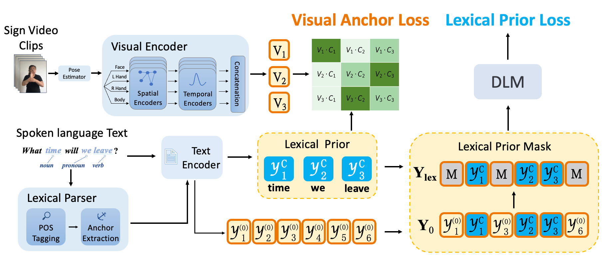

<h3 align="center"><a href="" style="color:#9C276A">
LPG-DLM: Lexical-Prior Guided Diffusion Models for Sign Language Translation</a></h3>
<h5 align="center"> 
If you find this project helpful, we would greatly appreciate a star on GitHub. Your support is a huge motivation for us.
</h2>




## Installation
We suggest to create a new conda environment. 
```bash
# create environment
conda create --name LPG-DLM python=3.9
conda activate LPG-DLM
# install other relevant dependencies
pip install -r requirements.txt
```

## Data Preparation
1. Download the [LLaDA](https://huggingface.co/GSAI-ML/LLaDA-8B-Instruct) weights, and place them in the `./pretrained_weight/LLaDA/`.

2. Download the [CSL-News](https://huggingface.co/datasets/ZechengLi19/CSL-News) and [CSL-Daily](https://ustc-slr.github.io/datasets/2021_csl_daily/) dataset.

3. Using the provided code to extract the poses from the videos:
```bash
# Note: Please specify the paths for {video_dir} and {pose_dir} before running command
# The {video_dir} directory contains multiple .mp4 files.
python ./extras/pose_extraction.py \
    --src_dir {video_dir} \
    --tgt_dir {pose_dir}
```
Note that to run the code on GPU, you need to install the required dependencies.

```bash
pip install onnxruntime-gpu cuda-toolkit
cd ./extras/rtmlib-main
pip install -e .
```

For simplicity, you can reuse the preprocessed datasets provided in the [CSL-News-Pose](https://huggingface.co/datasets/ZechengLi19/CSL-News_pose) and [Uni-Sign](https://huggingface.co/ZechengLi19/Uni-Sign) datasets, you only need to download the `csl_daily_pose_format.zip` file for the CSL-Daily dataset.

4. Extract lexical anchors using off-the-shelf modules.
You can refer to the instruction file [Lexical_Extraction.md](./extras/Lexical_Extraction.md) for details.

5. The final structure of the poses and labels are as follows:
```bash
LPG-DLM/data/
├── CSL_News
│   ├── labels
│   │   ├── train_ready_news.json
│   │   └── ...
│   │ 
│   └── poses
│       ├── Pose keypoints file[in .pkl format] like Common-Concerns_20201113_0-287_14330.pkl
│       └── ...
│      
├── CSL_Daily
│   ├── labels
│   │   ├── train_ready_daily.json
│   │   ├── dev_ready_daily.json
│   │   └── test_ready_daily.json
│   │ 
│   └── poses
│       ├── Pose keypoints file[in .pkl format] like S005870_P0006_T00.pkl
│       └── ...
```


## Training & Evaluation
All scripts must be executed within the LPG-DLM directory. 

### Training
**Pretraining**
```bash
bash ./script/pretrain.sh
```
**Fine-tuning**
```bash
bash ./script/train.sh
```

### Evaluation
After completing Fine-tuning, performance evaluation on a single GPU can be performed using the following command:
```bash
bash ./script/eval_lpgdlm.sh
```

## 👍 Acknowledgement
The codebase of LPG-DLM builds upon the framework of Uni-Sign. We extend our sincere gratitude to the authors of Uni-Sign for developing and sharing such a valuable foundation for sign language translation research.
We would also like to express our appreciation to the following projects, which have contributed to the development of LPG-DLM:
* [LLaDA](https://github.com/ML-GSAI/LLaDA): A large language diffusion model that serves as the backbone of our LPG-DLM system.
* [MMPose](https://github.com/open-mmlab/mmpose): an open-source toolbox for pose estimation.


<!-- ## 📑 Citation
If you find LPG-DLM useful for your research and applications, please cite using this BibTeX:
```
xxx
``` -->